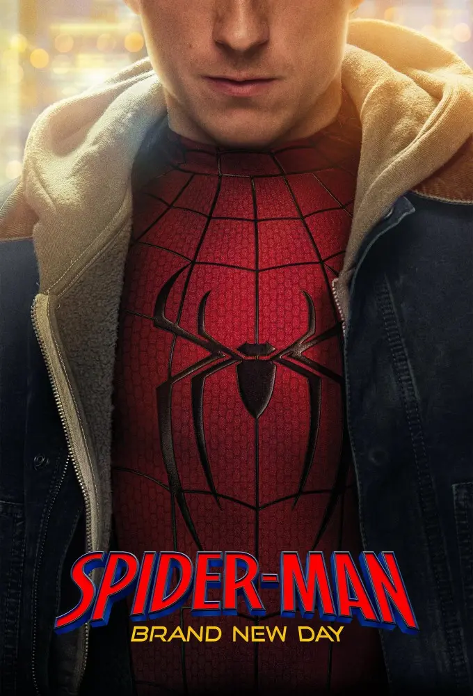

---
tags:
  - post
layout: post
thetvdb_movie_id: "135896"
title:  "🎬 Spider-Man: Brand New Day"
summary: "My thoughts and opinions on this movie"
date: 2026-10-21T23:41:56+0530
categories: 
  - "movies"
---

  

Score: 4/5 👌

> Four years have gone by since we last caught up with our friendly neighborhood hero. Peter Parker is no more, but Spider-Man is at the top of his game keeping New York City safe. Things are going well for our anonymous hero until an unusual trail of crimes pulls him into a web of mystery larger than he’s ever faced before. In order to take on what’s ahead, Spider-Man not only needs to be at the top of his physical and mental game, but he must also be prepared to face the repercussions of his past!
>
> — [TheTVDB.com](https://www.thetvdb.com/movies/untitled-spider-man-sequel-2)

I planned to watch this in theatre when it released. I even got the tickets for a show but couldn't go because of heavy rains, and after that couldn't manage to find time. I finally watched it this Sunday and it was a wonderful movie.

I had no idea that Spider-Man and Punisher would have such an awesome on-screen friendship. I would have liked the Hulk to have more screen-time, but it is understandable that it would have been difficult to manage the Hulk with the strength of the other characters.

If given a chance I would like to watch this movie again, hopefully on a big-screen once. If you like Spider-Man movies (or superhero movies in general) then this one won't disappoint.
