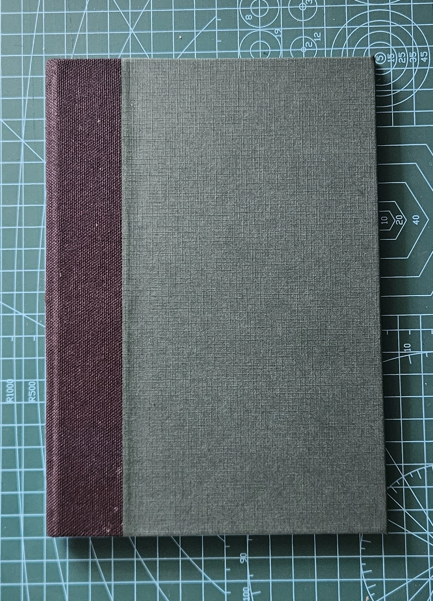

---
tags:
  - post
layout: post
title:  "I made a notebook I am proud of"
summary: "My first time doing a single-section pamphlet binding"
date: 2026-11-05T01:54:20+0530
categories: 
  - "bookbinding"
---

I resumed my bookbinding hobby back in [May this year](/blog/first-bookbinding-project). I was not satisfied with the first notebook that I made and wanted to improve on it.

This time rather than doing a mish-mash of multiple videos and trying to follow the best parts from each of them, I decided to focus on a single source. I went with the [Single Section Pamphlet binding guide by DAS Bookbinding](https://www.youtube.com/watch?v=sdZ3fLYmMVA), in this one he demonstrates a technique [documented by Randy Silverman in 1987](https://cool.culturalheritage.org/coolaic/sg/bpg/annual/v06/bp06-13.html). This guy's videos and bindings are not as flashy as many other people out there but all of them are rock-solid in terms of durability. And his final books always look as clean as any professionally made book out there.

## Better Materials

Meanwhile, I had acquired some better supplies which also made a new attempt much more likely to succeed. I had found a local shop selling greyboard which works much better than the cardboard I had used previously. I had acquired some nice canvas and some textured paper to make a nice cover.

I used 8+2 A4 pages (folded in half) which gave me 32 writable pages in the final product. My covering material was going to be a black canvas for the spine and a textured green paper for the rest of the cover. At the end I decided to add a simple printed label on the front.

## Better Tools & Setup

This time I had a proper cutting-mat to cut the text-block and board on. While I still haven't been able to make a bench-hook like the one shown in DAS Bookbinding's videos, I attached a piece of wood with a straight-edge to the rear-end of my table. So I had a proper surface to butt-up my ruler against. This along with having a thinner stack of paper to trim caused the edges and corners to be much better aligned.

Another thing I changed was to use a brush to apply the glue. This allowed me to put down a much thinner and even coat of the glue. This both helped ensure faster glue setting time and it also caused the warping to be much lesser.

<figure>
   
  <figcaption>Singular Teacher + Better Materials + Better Tools = Better Notebook</figcaption>
</figure>

> I only have this one photo right now, will update this post with more images in a few days.

The book lays completely flat when closed, no warping of the cover or boards. And it opens completely flat, so it is a breeze to write into.

All of this happened back in June/July this year. And I was so happy/proud with what I had been able to create that I made a bunch of other notebooks to gift to a few friends when I visited Bangalore in August. A big thank you to my wife for helping me get them made.
